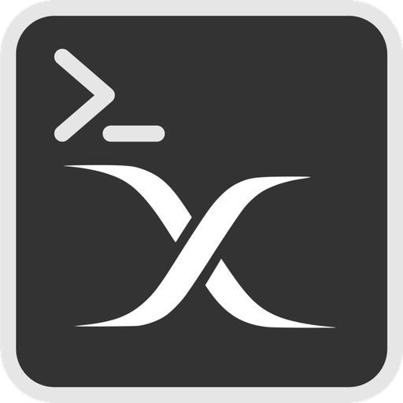
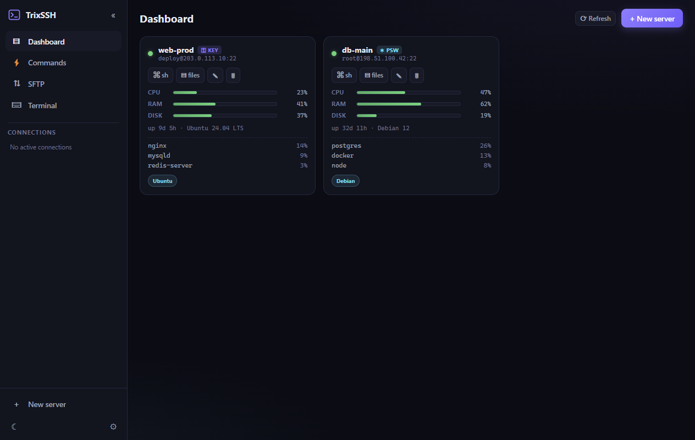
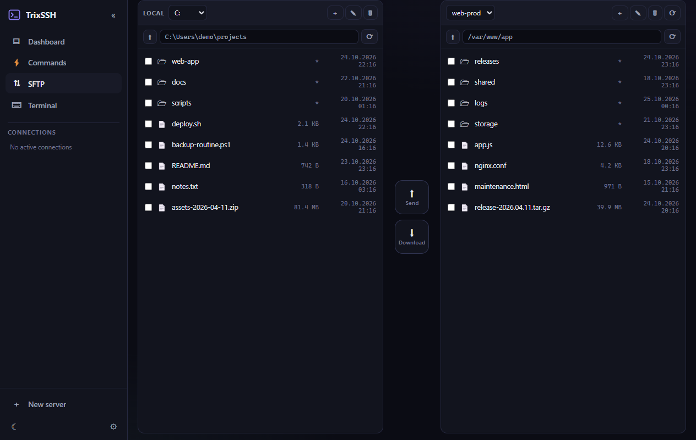
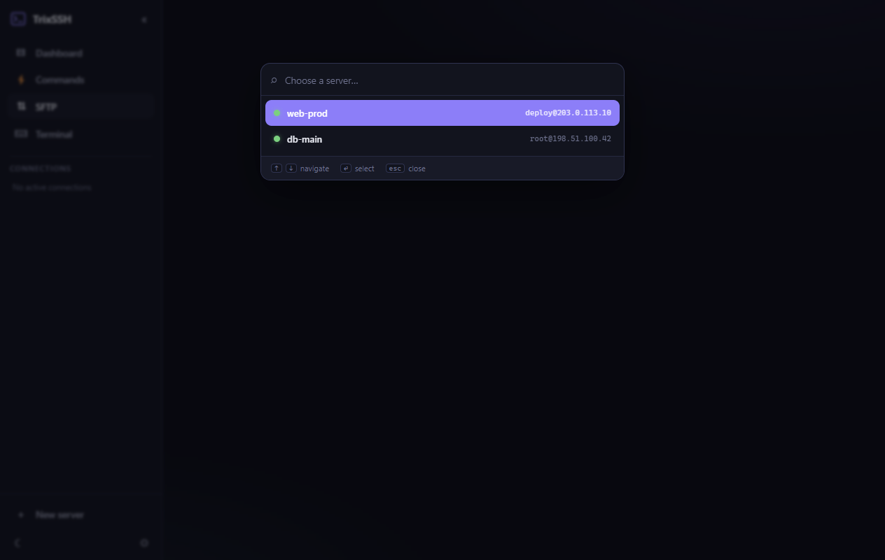
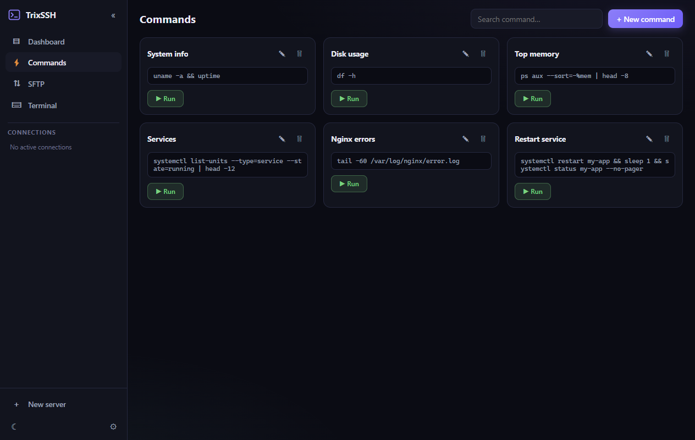
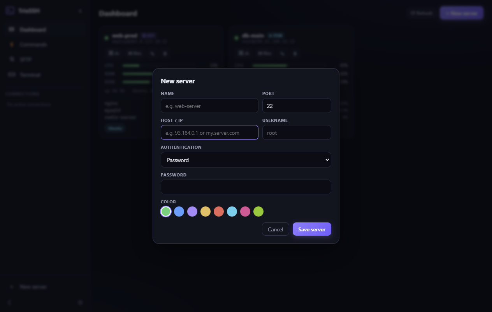
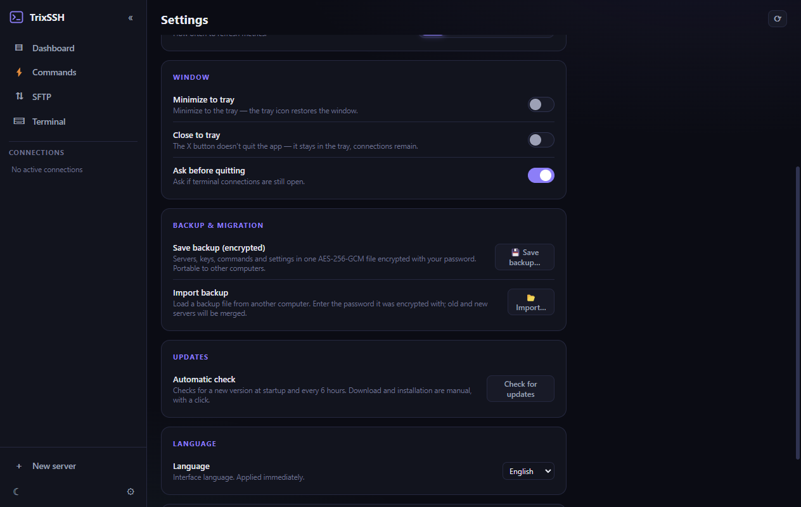

<div align="center">



# TrixSSH

**Fast desktop SSH client for Windows, macOS and Linux** — tabs, SFTP, live metrics, snippets, broadcast and auto-updates.

Inspired by OmnySSH. Open source, no telemetry, localized in 7 languages.

[](https://github.com/Hatrix-Digital/TrixSSH/releases)
[](https://github.com/Hatrix-Digital/TrixSSH/releases)
[](LICENSE)
[](https://www.electronjs.org)

**▶ [Download the latest version](https://github.com/Hatrix-Digital/TrixSSH/releases/latest)**

</div>

## Screenshots

| | |
|---|---|
| **Dashboard** — live CPU/RAM/Disk, uptime, top processes |  |
| **SFTP** — dual pane, recursive folder transfer, progress |  |
| **SFTP server picker** — search + status dots |  |
| **Commands** — saved snippets, one-click run |  |
| **New server** — password or private key auth |  |
| **Settings** — theme, privacy, tray, updates, languages |  |

*(Demo data — all servers, files and metrics in the screenshots are fictional.)*

---

## Features

### 🗄 Dashboard
- Server cards with metrics: **CPU / RAM / DISK** bars, **uptime**, **OS**, **top processes**
- Automatic refresh; works on Linux servers (reads `/proc/*` and `df -kP`)
- Card actions → open a **Terminal** or **SFTP** directly on that server

### ⌨ Terminal
- **Tabs** — multiple connections at once (xterm.js, 256 colors, 20 000-line scrollback)
- **Snippets** — saved commands, one click away (`Ctrl+E` for a new one)
- **Broadcast** — send the same command to multiple servers at once (`Ctrl+B`)
- Copy/paste: `Ctrl+C` / `Ctrl+V` (and `Ctrl+Shift+C` / `Ctrl+Shift+V`)

### 📁 SFTP browser
- **Dual pane**: local machine ↔ server (navigation, Windows drives)
- Upload/download with a **progress bar** — **including entire folders, recursively**
- New folder, delete (recursive, both sides), rename
- **"Choose a server…" picker** — search, `↑ ↓` navigation, `⏎` select, `esc` close, online/connecting/offline status dots
- Clicking **SFTP** in the sidebar always opens the picker first (like OmnySSH)

### 🖱 Context menus everywhere
- SFTP rows (download / upload / rename / delete) and empty panes (new folder, upload)
- Tabs (close / close others), terminal (copy / paste / clear / reconnect)
- Dashboard cards (Terminal / SFTP / Edit / Delete) and sidebar connections

### 🔒 Security & privacy
- Passwords and passphrases are **encrypted** — Electron `safeStorage` (Windows DPAPI); never stored in plain text
- Data stays local: `%APPDATA%\TrixSSH` — **no telemetry, no cloud**
- **Private key** from disk (file picker) or paste — OpenSSH format; warns about PuTTY `.ppk`
- **Backup & migration** — export settings to a `.trixbak` file (AES-256-GCM + scrypt, password protected), import on another computer; DPAPI secrets are re-encrypted on import

### 🌍 Languages
English · Deutsch · Français · Italiano · Hrvatski · Bosanski · Srpski — set in **Settings → Language**, applied immediately.

### ⚙ Also
- Dark / light theme
- Minimize and close to tray (optional)
- **Auto-updates** — checked at startup and every 6 h; modal with the new version, download progress and one-click install; manual check in Settings

## Keyboard shortcuts

| Shortcut | Action |
|---|---|
| `Ctrl+T` | new connection (new tab) |
| `Ctrl+W` | close tab |
| `Ctrl+R` | reconnect active tab |
| `Ctrl+B` | broadcast |
| `Ctrl+E` | new snippet |
| `Ctrl+F` | search servers |
| `Ctrl+N` | new server |
| `Ctrl+1..9` / `Ctrl+Tab` | switch tabs |
| `Ctrl+2..4` | commands / SFTP / terminal |

## Download

| Platform | Artifact |
|---|---|
| **Windows 10/11 (x64)** | `TrixSSH-Setup-1.0.0.exe` (installer) or `TrixSSH-v1.0.0-win64-portable.zip` |
| **macOS** | `TrixSSH-1.0.0.dmg` (drag to Applications) |
| **Linux (x64)** | `TrixSSH-1.0.0-x86_64.AppImage` or `TrixSSH-1.0.0-amd64.deb` |

Grab them from the [Releases](https://github.com/Hatrix-Digital/TrixSSH/releases) page.

> Windows SmartScreen may show a warning (not code-signed yet) — *More info → Run anyway*.
> On macOS, right-click the app → *Open* the first time (unsigned). AppImage may need `libfuse2`.

## How auto-update works

TrixSSH checks a `latest.json` manifest (env `TRIX_UPDATE_MANIFEST` → `updateUrl` setting → `UPDATE_MANIFEST_URL` constant in `src/main/main.js`):

```json
{
  "version": "1.0.1",
  "url": "https://github.com/Hatrix-Digital/TrixSSH/releases/download/v1.0.1/TrixSSH-Setup-1.0.1.exe",
  "macUrl": "https://github.com/Hatrix-Digital/TrixSSH/releases/download/v1.0.1/TrixSSH-1.0.1.dmg",
  "linuxUrl": "https://github.com/Hatrix-Digital/TrixSSH/releases/download/v1.0.1/TrixSSH-1.0.1-x86_64.AppImage",
  "notes": "Fixes and new features..."
}
```

If `version` is newer than the running one, a modal with download appears. **Windows:** one-click install (silent NSIS). **macOS/Linux:** the platform download opens in the default browser. Redirects and local paths (`file:///`) are supported for testing.

## For developers

### Run (dev)

```bash
npm install
npm start
```

### Build

```bash
npm run build        # Windows: NSIS installer + rcedit icon patch
npm run build:mac    # macOS: DMG + ZIP (best on a mac or via CI)
npm run build:linux  # Linux: AppImage + deb
```

Windows artifacts:
- `dist/TrixSSH-Setup-<version>.exe` — NSIS installer
- `dist/win-unpacked/TrixSSH.exe` — portable version

> The icon and version info are embedded into the exe via an rcedit patch script (`scripts/patch-exe-icon.js`), because electron-builder has a known symlink issue with the winCodeSign cache on plain Windows without admin rights.

### Publishing a release

1. Bump the version in `package.json` (e.g. `1.0.1`) and commit
2. `git tag v1.0.1 && git push origin v1.0.1` — the GitHub Actions workflow (`release.yml`) builds all three platforms (build matrix: windows-latest, macos-latest, ubuntu-latest) and creates a draft Release
3. Update `latest.json` (new version + per-platform URLs + notes) — existing installations will be notified automatically

### Translations

The UI source language is Croatian (`src/renderer/i18n.js`). Dictionaries map Croatian source strings to the target language; missing entries fall back to the original. The DOM is translated at startup (text nodes, placeholders, titles) and dynamic strings go through `T.i18n.tr()`.

## Project structure

```
src/main/main.js           connections (ssh2), SFTP with recursive transfer, metrics, backup, auto-update, tray, test modes
src/main/preload.js        contextBridge — secure renderer ↔ main bridge
src/main/assets/           app icon (ico + png) for the window and tray
src/renderer/app.js        views, tabs, terminal, snippets, broadcast, update modal, server picker
src/renderer/sftp.js       dual-pane SFTP browser + transfer progress
src/renderer/common.js     toasts, formatting, prompt, context menu, host masking
src/renderer/i18n.js       translations (hr, en, de, fr, it, bs, sr)
src/renderer/index.html    UI shell and overlays (picker, modals)
src/renderer/style.css     dark/light theme
scripts/make-icon-from-logo.js  logo PDF → icon (sharp + png-to-ico)
scripts/patch-exe-icon.js  rcedit: icon + version into the exe after build
```

## License

[MIT](LICENSE) © 2026 Hatrix Digital
